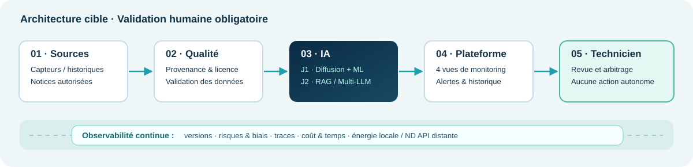

# 🩺 RoboCare Sentinel
### AI-assisted medical equipment maintenance · Projet fil rouge ECE Paris

**MSc2 Artificial Intelligence** · **Prototype de recherche et d'application web**

[📋 Jira / Backlog](https://gemimakerenondelepourou.atlassian.net/jira/software/projects/RCS/boards/1/backlog) · [🔀 Pull Requests](https://github.com/GemimaOndele/Generative-ai-and-diffusion-models-project/pulls) · [🧭 Guide d'équipe](CONTRIBUTING.md) · [🧪 Prototype web (PR #8)](https://github.com/GemimaOndele/Generative-ai-and-diffusion-models-project/pull/8)

`🧩 Application web` · `🧠 Diffusion & anomaly detection` · `🤝 Multi-LLM & RAG` · `🌱 Green AI / FinOps` · `🛡️ Human-in-the-loop`

> [!IMPORTANT]
> **Projet pédagogique en développement — pas un dispositif médical validé.** Les données industrielles ou fictives ne prouvent aucune efficacité hospitalière. L'IA ne diagnostique aucun patient, ne commande aucune machine et ne remplace jamais le technicien biomédical habilité.

## ✨ Le projet en une minute

**RoboCare Sentinel** vise à développer une **plateforme web d'aide à la maintenance biomédicale** qui rassemble des données techniques autorisées, détecte expérimentalement des anomalies, facilite l'analyse de documents et présente les informations nécessaires à une **décision humaine traçable**.

La **famille pilote de machines**, l'accès aux données et les choix définitifs des modèles sont **encore à valider collectivement**. Les scénarios fictifs servent exclusivement au développement et à la démonstration.

### 🧭 Quatre volets de monitoring prévus

| Vue | Objectif métier | État |
|:---|:---|:---|
| 🏥 **Parc équipements** | Inventaire, familles, statut et historique | Prototype fictif en [PR #8](https://github.com/GemimaOndele/Generative-ai-and-diffusion-models-project/pull/8) |
| 📈 **Données & anomalies** | Qualité d'entrée, alertes, faux positifs/négatifs, dérive | Prototype fictif ; aucune métrique médicale validée |
| 🧰 **Maintenance & interventions** | Revue technicien, décisions et interventions tracées | Parcours fictif ; aucune action sur machine |
| 🌿 **Plateforme & Green AI** | Versions, qualité, latence, budget, coût humain, CodeCarbon local | Contrats préparés ; mesures réelles **ND** |

**Démonstration locale du prototype (branche PR #8, pas encore fusionnée)** :
`python -m http.server 8000`, puis ouvrir `http://localhost:8000/frontend/monitoring/`.

## 🔬 Deux jalons scientifiques, trois consignes pédagogiques

| Module | Séance | Ce qu'il faut démontrer | Préparation dans GitHub |
|:---|:---|:---|:---|
| **C3 · GenAI / diffusion** | **60 min** | 8–10 cas gelés, modèle de diffusion véritable, comparaison à une baseline, erreur analysée | [PR #2](https://github.com/GemimaOndele/Generative-ai-and-diffusion-models-project/pull/2) et [PR #7](https://github.com/GemimaOndele/Generative-ai-and-diffusion-models-project/pull/7) |
| **TP04 · Multi-LLM** | **120 min + 30 min facultatives** | Mono-A / mono-B / V2 (routing ou cascade) sur les mêmes 10 cas dont 4 stress, citations et mesures | [PR #2](https://github.com/GemimaOndele/Generative-ai-and-diffusion-models-project/pull/2), [PR #9](https://github.com/GemimaOndele/Generative-ai-and-diffusion-models-project/pull/9) |
| **TP05 · FinOps, Green AI & Éthique** | **90 min**, *complément de J2* | Coût par tâche réussie, énergie/CO₂e avec frontières claires, ≥3 risques éthiques et ≥1 test tracé | [PR #3](https://github.com/GemimaOndele/Generative-ai-and-diffusion-models-project/pull/3), [PR #5](https://github.com/GemimaOndele/Generative-ai-and-diffusion-models-project/pull/5), [PR #9](https://github.com/GemimaOndele/Generative-ai-and-diffusion-models-project/pull/9) |

**TP05 ne crée pas de troisième jalon.** Un mock ne démontre pas les performances d'un LLM, un simple bruitage n'atteste pas l'apprentissage d'une diffusion et **CodeCarbon exécuté localement ne mesure pas l'énergie des serveurs LLM distants**.

## 🧩 Architecture technique et traçabilité

- **Données** : Python, collecte/qualité, sources sous licence, manifest et *dataset cards* ; modélisation MCD/MLD avec **JMerise** avant implémentation SQL.
- **IA J1** : baseline ML et véritable modèle génératif à comparer sur un jeu de test séparé.
- **IA J2** : documentation autorisée → RAG → LLM A/B → routeur/cascade → citations, refus et validation humaine.
- **Web** : prototype HTML/CSS/JavaScript puis intégration API et base selon les décisions d'architecture.
- **Observabilité dès le début** : `trace_id`, `run_id`, version modèle/dataset/prompt/code, erreurs, p95, métriques, coûts, effort humain, risques/biais et énergie locale estimée si mesurable.
- **Gouvernance** : registre de décisions, cartographie probabilité × impact, fiches modèles/données, revues, suivi FinOps et politique de rollback.

Ces composants sont **cibles ou en cours de développement**, pas un système hospitalier déjà déployé.

## 👥 L'équipe

| Membre | Domaine de référence | Missions initiales / binômes |
|:---|:---|:---|
| **Gémima** | Coordination, cohérence métier–données, budget | Sprint 0 [RCS-17](https://gemimakerenondelepourou.atlassian.net/browse/RCS-17) · Monitoring [RCS-38](https://gemimakerenondelepourou.atlassian.net/browse/RCS-38) · Coût [RCS-90](https://gemimakerenondelepourou.atlassian.net/browse/RCS-90) |
| **Aminata** | Fonctionnel, cas de test, éthique | TP04 RCS-74 · Éthique RCS-84 · Binôme monitoring/biais |
| **Omar** | Data Engineering, JMerise, baselines, FinOps | Jira RCS-16 · Baseline RCS-71 · FinOps RCS-82 |
| **Elias** | Diffusion, LLM, évaluation des biais | Diffusion RCS-70 · Modèles A/B RCS-75 · Biais RCS-88 |
| **Ayoub** | Architecture, intégration, CI, monitoring | Socle GitHub RCS-46/48 · Versionnement RCS-87 · Traces RCS-89 |

**52 missions historiques validées**, complétées par les tâches pédagogiques et de gouvernance. Les nouvelles attributions RCS-81 à RCS-90 sont **à ratifier** ; chaque ticket précise responsable, binôme, relais et relecteur.

## 🚦 État réel du dépôt — audit du 21 novembre 2026

| Sujet | État constaté |
|:---|:---|
| Branche `main` | **Protégée**, mais ne contient actuellement que ce README dans sa version ancienne ; la mise à jour est proposée dans [PR #1](https://github.com/GemimaOndele/Generative-ai-and-diffusion-models-project/pull/1) |
| Structure web / backend / IA | Préparée sur [PR #1](https://github.com/GemimaOndele/Generative-ai-and-diffusion-models-project/pull/1), **pas encore dans `main`** |
| Protocoles C3, TP04, TP05 | En branches / Pull Requests, **pas encore des résultats scientifiques validés** |
| Prototype web 4 vues | [PR #8](https://github.com/GemimaOndele/Generative-ai-and-diffusion-models-project/pull/8), tests CI réussis sur données fictives |
| Code coût, évaluation et monitoring | [PR #5](https://github.com/GemimaOndele/Generative-ai-and-diffusion-models-project/pull/5), [PR #9](https://github.com/GemimaOndele/Generative-ai-and-diffusion-models-project/pull/9), autres PR |
| Sprint 0 | **Futur** ; calendrier proposé à confirmer, non démarré |
| Revue PR #1 | Demandée aux quatre autres membres, **aucune approbation** au dernier contrôle |

📂 [Voir toutes les PR](https://github.com/GemimaOndele/Generative-ai-and-diffusion-models-project/pulls) · 📑 [Audit technique détaillé](docs/GITHUB_AUDIT_2026-11-21.md) · 🔐 [Règle de protection de main](https://github.com/GemimaOndele/Generative-ai-and-diffusion-models-project/rules/27460937)

**Ne pas confondre « code en branche + tests verts » avec « fonctionnalité intégrée et validée dans `main` ».**

## 🌐 Vitrine GitHub Pages — prête à publier après validation

Une page de présentation animée, responsive et accessible est préparée dans [`docs/index.html`](docs/index.html), avec [styles](docs/landing.css), [navigation](docs/landing.js) et visuels originaux. **Une copie autonome est désormais versionnée dans la branche [`gh-pages`](https://github.com/GemimaOndele/Generative-ai-and-diffusion-models-project/tree/gh-pages), sans dépendre de la fusion de PR #1.** GitHub Pages n'est pas encore activé : publier en choisissant `gh-pages / (root)` dans Settings → Pages. Le README de `main` demeure ancien tant que PR #1 n'est pas fusionnée.

- [Guide de publication GitHub Pages](docs/README_PAGES.md)
- [Paramètres About / Topics / Homepage proposés](.github/REPOSITORY_PROFILE.md)
- Prévisualisation locale après checkout de PR #1 : `python -m http.server 8000 --directory docs`.

## 🚀 Démarrer et contribuer

1. Se connecter au [projet Jira](https://gemimakerenondelepourou.atlassian.net/jira/software/projects/RCS/boards/1/backlog) et sélectionner son ticket RCS-XX (responsable/binôme/relecteur connus).
2. Examiner d'abord la [**PR #1 — socle commun**](https://github.com/GemimaOndele/Generative-ai-and-diffusion-models-project/pull/1) : approuver ou demander des corrections. **Pas besoin de finir son propre code avant cette revue.**
3. Après fusion approuvée, synchroniser `main`, puis créer une **branche temporaire par ticket** : `feature/RCS-XX-sujet`, `experiment/RCS-XX-sujet`, `docs/RCS-XX-sujet`…
4. Écrire code **et tests**, citer ses sources/versions et ses risques, créer une PR et demander une revue à un autre membre. Une CI réussie ne dispense pas de la revue.
5. Une fois la PR fusionnée et vérifiée, **supprimer normalement la branche temporaire** si elle ne contient plus de travail non intégré. Conserver les versions stables par tags/releases et registre d'artefacts.

⚙️ Les règles complètes sont dans [CONTRIBUTING.md](CONTRIBUTING.md). L'éditeur **Cursor, VS Code ou autre** peut ouvrir le même dépôt et les mêmes branches.

### 📅 Proposition de Sprint 0 — à approuver, pas encore planifiée dans Jira

**Du lundi 23 novembre au dimanche 6 décembre 2026** (deux semaines de préparation compatible avec des semaines étudiantes chargées).

- **Réponse rapide des cinq membres** : accord sur le principe et créneaux possibles avant le **dimanche 22 novembre à 20 h** (Paris).
- **Réunion de lancement proposée** : **mardi 24 novembre à 20 h 30** (30 min, à décaler si nécessaire).
- **Suivi léger asynchrone** : chaque jeudi (26/11 et 03/12), par Jira/WhatsApp, sans imposer une réunion supplémentaire.
- **Revue proposée** : **dimanche 6 décembre à 18 h** (30 min).

Le groupe peut raccourcir, allonger ou décaler ces dates : aucune date n'est **validée** avant retour collectif, et le Sprint Jira reste **futur**.

## 📚 Documentation et conformité des données

Les documents collaboratifs **fiche d'équipe V5, bibliothèque V3.6 et cahier des charges V1.3** ont été reportés par la coordinatrice dans le **Drive partagé**. Ils complètent la documentation technique de GitHub, qui conserve les scripts, versions, preuves et Pull Requests.

**Sécurité :** aucun nom de patient, secret, rapport clinique non autorisé ni dataset sensible dans ce dépôt public. Des sources de maintenance industrielles/simulées doivent rester clairement identifiées comme non médicales. Les modèles et métriques n'ont pas de validation clinique.

**Ressources :** [CodeCarbon](https://docs.codecarbon.io/latest/) · [FinOps Foundation](https://www.finops.org/) · [Conventions GitHub](CONTRIBUTING.md).

**RoboCare Sentinel · From data to dependable decisions, with a human in control.**

*ECE Paris · MSc2 AI · 2026–2027*

