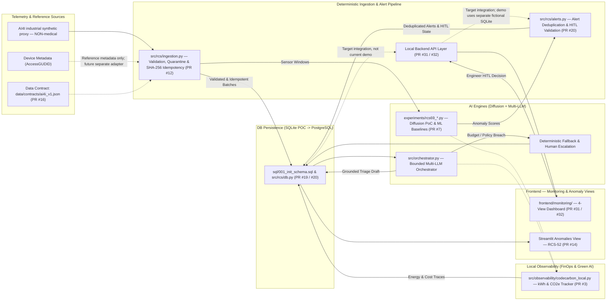

# RoboCare Sentinel — Architecture v1 (`RCS-43`)

> **Status**: Draft v1 aligned with open PRs (`RCS-43`)  
> **Domain**: Predictive maintenance & anomaly triage for **biomedical equipment (multi-family scope; pilot family pending RCS-19 / DEC-02)** (decision-support only; human-in-the-loop mandatory, zero autonomous actuation on medical devices).

---

## 1. Architectural Goals & Safety Boundaries

1. **Deterministic Ingestion & Deduplication**: Telemetry and maintenance CSV/JSON batches are validated against `data/contracts/ai4i_v1.json`, hashed (`SHA-256`) for idempotency in `src/rcs/ingestion.py`, quarantined on schema errors, and deduplicated before alert creation.
2. **4-View Monitoring & Anomalies Frontend**: Biomedical engineers monitor equipment fleet health, anomaly scores, alert queues, and audit/cost traces via `frontend/monitoring/` (4-view dashboard) and the Streamlit anomalies view (`RCS-52`).
3. **Diffusion + Multi-LLM Bounded Orchestrator**:
   - **Diffusion / Baseline Anomaly Engine (J1)**: Compares rule/ML baselines against the temporal diffusion PoC (`experiments/rcs69_*.py`) to score anomalies on synthetic signals or the non-medical industrial proxy; no demonstrated clinical drift detection.
   - **Multi-LLM Bounded Orchestrator (J2)**: Routes anomaly triage and maintenance recommendations in `src/orchestrator.py` under strict token, latency, and cost budgets, with citation checks and deterministic fallback to human review.
4. **Local CodeCarbon Observability**: Estimates local compute energy (kWh) and estimated CO2e in `src/observability/codecarbon_local.py` alongside latency and EUR cost per successful task (FinOps & Green AI).
5. **Human-in-the-Loop (HITL) Guarantee**: All alerts in `src/rcs/alerts.py` require biomedical engineer validation (`a_qualifier` → `validee` / `rejetee`). The system never sends commands to physical medical equipment.

---

## 2. System Architecture Diagram

---

## 3. Component-to-Repository Mapping

| Layer | Component | Repository Path(s) | Open PR(s) / Ticket | Responsibility |
| :--- | :--- | :--- | :--- | :--- |
| **Frontend** | 4-View Monitoring Dashboard | `frontend/monitoring/` (`index.html`, `app.js`, `ai4i_preview.*`, `demo.json`, `style.css`) | PR #31, PR #32 (`RCS-38`) | Fleet overview, measurements/anomalies, alert triage, and observability views. |
| **Frontend** | Streamlit Anomalies View | Streamlit view & `scripts/demo_pipeline.py` | PR #14 (`RCS-52`) | Interactive inspection of measurements, anomaly scores, and source traceability. |
| **Data Contract** | Versioned JSON Contract | `data/contracts/ai4i_v1.json` | PR #16 (`RCS-40`) | Formal schema, types, bounds, and provenance rules for incoming batches. |
| **DB Persistence** | Schema & Data Access | `sql/001_init_schema.sql`, `src/rcs/db.py` | PR #19 (`RCS-42`), PR #20 (`RCS-50`) | Relational schema (`PK`/`FK`/`CHECK`/`UNIQUE`) and SQLite POC persistence for measurements, alerts, and audit logs. |
| **Ingestion** | Deterministic CSV Ingestion | `src/rcs/ingestion.py` | PR #12 (`RCS-49`) | Contract validation, invalid-row quarantine, `SHA-256` idempotency, and import manifests. |
| **Alerts & HITL** | Alert Deduplication & Review | `src/rcs/alerts.py` | PR #20 (`RCS-50`) | Deduplicated alert lifecycle and mandatory human-in-the-loop sign-off with audit trail. |
| **AI — J1** | Diffusion PoC & Baselines | `experiments/rcs69_*.py` | PR #7 (`RCS-69`) | Synthetic DDPM reconstruction/generation PoC and baseline anomaly comparison. |
| **AI — J2** | Multi-LLM Orchestrator | `src/orchestrator.py` | PR #30 (`RCS-75`), #34 (`RCS-61`) | Bounded routing/cascade orchestrator with token/cost/latency guards and fallback. |
| **Observability** | Local CodeCarbon Tracker | `src/observability/codecarbon_local.py` | PR #3 (`RCS-81`) | Local energy (kWh) and CO2e tracking for FinOps and Green AI reporting. |

---

## 4. Integration & Merge Order

PR #1 is merged. The paths below exist on feature branches or are target interfaces, not a deployed integrated system. Do not merge overlapping files independently.

1. Review data contract #16 and canonical SQL #19; align #12 (ingestion), #20 (storage/HITL), #14 (Streamlit) and #23 (cross-integration) with that schema. Verify the complete pipeline after integration.
2. Review #30 before #34; #29 before #33; #31 before #32. Retarget dependent PRs to main after the parent integration and rerun CI.
3. PRs #8 and #22 are superseded by #31 and #32 respectively; do not merge duplicate implementations.
4. #3 and #7 require their own reviews and scientific evidence. The four-view prototype uses fictional fixtures and its own local SQLite; #32 is read-only AI4I export, not live biomedical control.

## 5. Storage architecture decision (proposed)

- Relational SQL supports transactional integrity for observation, alert, human decision, intervention and audit (FK, CHECK, UNIQUE).
- SQLite is appropriate for the local single-user POC and the approximately 10,000-row AI4I proxy; reproducible without a server. No production authentication is claimed.
- A warehouse or medallion infrastructure is disproportionate at this stage. The logical layers are raw data/hash (bronze), validated observations/quarantine (silver), analyses and alerts (gold), without claiming a deployed lakehouse.
- PostgreSQL is a candidate when concurrent users, access controls, backup and operations require it; migration and security review are prerequisites.
- AI4I is a synthetic industrial non-medical dataset; no biomedical telemetry or pilot family is approved by this architecture. CodeCarbon estimates local energy only; remote energy remains ND. The diagram shows target links, not all currently implemented integrations.
