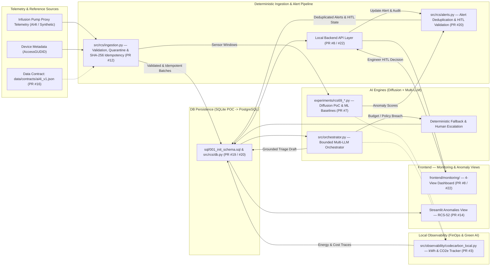

# RoboCare Sentinel — Architecture v1 (`RCS-43`)

> **Status**: Draft v1 aligned with open PRs (`RCS-43`)  
> **Domain**: Predictive maintenance & anomaly triage for **hospital infusion pumps** (decision-support only; human-in-the-loop mandatory, zero autonomous actuation on medical devices).

---

## 1. Architectural Goals & Safety Boundaries

1. **Deterministic Ingestion & Deduplication**: Telemetry and maintenance CSV/JSON batches are validated against `data/contracts/ai4i_v1.json`, hashed (`SHA-256`) for idempotency in `src/rcs/ingestion.py`, quarantined on schema errors, and deduplicated before alert creation.
2. **4-View Monitoring & Anomalies Frontend**: Biomedical engineers monitor pump fleet health, anomaly scores, alert queues, and audit/cost traces via `frontend/monitoring/` (4-view dashboard) and the Streamlit anomalies view (`RCS-52`).
3. **Diffusion + Multi-LLM Bounded Orchestrator**:
   - **Diffusion / Baseline Anomaly Engine (J1)**: Compares rule/ML baselines against the temporal diffusion PoC (`experiments/rcs69_*.py`) to score subtle infusion-pump drift.
   - **Multi-LLM Bounded Orchestrator (J2)**: Routes anomaly triage and maintenance recommendations in `src/orchestrator.py` under strict token, latency, and cost budgets, with citation checks and deterministic fallback to human review.
4. **Local CodeCarbon Observability**: Measures local compute energy (kWh) and estimated CO2e in `src/observability/codecarbon_local.py` alongside latency and EUR cost per successful task (FinOps & Green AI).
5. **Human-in-the-Loop (HITL) Guarantee**: All alerts in `src/rcs/alerts.py` require biomedical engineer validation (`ack` / `escalate` / `false_positive`). The system never sends commands to physical infusion pumps.

---

## 2. System Architecture Diagram

---

## 3. Component-to-Repository Mapping

| Layer | Component | Repository Path(s) | Open PR(s) / Ticket | Responsibility |
| :--- | :--- | :--- | :--- | :--- |
| **Frontend** | 4-View Monitoring Dashboard | `frontend/monitoring/` (`index.html`, `app.js`, `ai4i_preview.*`, `demo.json`, `style.css`) | PR #8, PR #22 (`RCS-38`) | Fleet overview, measurements/anomalies, alert triage, and observability views. |
| **Frontend** | Streamlit Anomalies View | Streamlit view & `scripts/demo_pipeline.py` | PR #14 (`RCS-52`) | Interactive inspection of measurements, anomaly scores, and source traceability. |
| **Data Contract** | Versioned JSON Contract | `data/contracts/ai4i_v1.json` | PR #16 (`RCS-40`) | Formal schema, types, bounds, and provenance rules for incoming batches. |
| **DB Persistence** | Schema & Data Access | `sql/001_init_schema.sql`, `src/rcs/db.py` | PR #19 (`RCS-42`), PR #20 (`RCS-50`) | Relational schema (`PK`/`FK`/`CHECK`/`UNIQUE`) and SQLite POC persistence for measurements, alerts, and audit logs. |
| **Ingestion** | Deterministic CSV Ingestion | `src/rcs/ingestion.py` | PR #12 (`RCS-49`) | Contract validation, invalid-row quarantine, `SHA-256` idempotency, and import manifests. |
| **Alerts & HITL** | Alert Deduplication & Review | `src/rcs/alerts.py` | PR #20 (`RCS-50`) | Deduplicated alert lifecycle and mandatory human-in-the-loop sign-off with audit trail. |
| **AI — J1** | Diffusion PoC & Baselines | `experiments/rcs69_*.py` | PR #7 (`RCS-69`) | Synthetic DDPM reconstruction/generation PoC and baseline anomaly comparison. |
| **AI — J2** | Multi-LLM Orchestrator | `src/orchestrator.py` | PR #1 (`RCS-46`/`RCS-48`) | Bounded routing/cascade orchestrator with token/cost/latency guards and fallback. |
| **Observability** | Local CodeCarbon Tracker | `src/observability/codecarbon_local.py` | PR #3 (`RCS-81`) | Local energy (kWh) and CO2e tracking for FinOps and Green AI reporting. |

---

## 4. Integration & Merge Order

Several open PRs touch overlapping files on top of `origin/main` (`4bae384`). To avoid merge conflicts and schema drift, merge in the following order and rebase downstream branches after each step:

1. **Governance & Repo Scaffold (PR #1)** — owns root `README.md`, `.gitignore`, `CONTRIBUTING.md`, `.github/pull_request_template.md`, and `src/orchestrator.py`.
   * *Overlap*: `README.md` (and `.gitignore`) are also modified in **PR #8** and **PR #22**; rebase them onto `main` after PR #1 merges and keep `README.md` updates additive.
2. **Data Contract & Base Schema (PR #16 → PR #19)** — establishes `data/contracts/ai4i_v1.json`, `sql/001_init_schema.sql`, and `src/rcs/db.py`.
   * *Overlap*: `sql/001_init_schema.sql` and `src/rcs/db.py` are duplicated/extended across **PR #12**, **PR #14**, **PR #19**, **PR #20**, and **PR #23**. Merge **PR #19** first as the canonical schema, then rebase **PR #12** (`src/rcs/ingestion.py`) and **PR #20** (`src/rcs/alerts.py`) on top of it so a single `sql/001_init_schema.sql` and `src/rcs/db.py` survive.
3. **Observability & Models (PR #3, PR #7)** — independent paths (`src/observability/codecarbon_local.py`, `experiments/rcs69_*.py`), safe to merge in parallel once PR #1 is in.
4. **Frontend & Cross-Integration (PR #8 → PR #14 → PR #22 → PR #23)** — rebase onto the unified `src/rcs/` schema and run cross-integration checks (`PR #23`) before final merge.
