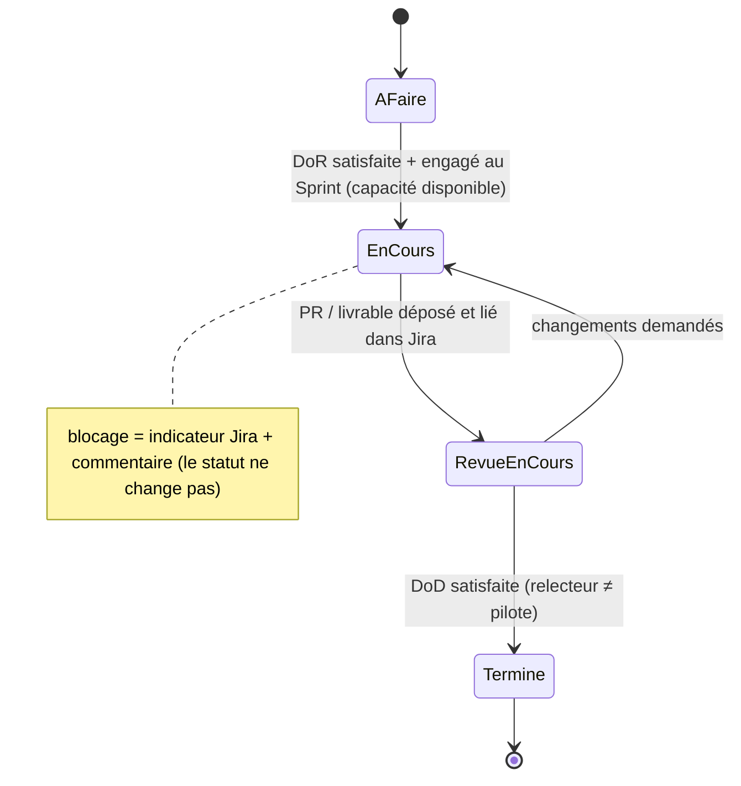

# RCS-16 — Statuts Jira, types d'issues et conventions (proposition à adopter)

Pilote : Omar · binôme : Elias · relais : Gémima · relectrice des critères : Aminata.

> **Statut : proposition en attente de validation de l'équipe — statut du ticket Jira inchangé.** Ce document détaille
> les éléments de méthode à examiner au Sprint 0 avec `docs/15_rcs17_sprint0_demarrage.md` (PR #6, RCS-17), dont il reprend la
> Definition of Ready et la Definition of Done, et avec `CONTRIBUTING.md` (PR #1, RCS-48) pour les branches et commits.
> Il s'applique au **workflow existant du projet RCS** créé par Gémima (À faire → En cours → Revue en cours →
> Terminé(e)), **sans reconfiguration** : les règles ci-dessous disent quand un ticket peut changer de statut.

## 1. Workflow (statuts réels du projet RCS)



| Statut Jira | Catégorie | Peut entrer si… | Peut sortir si… |
|---|---|---|---|
| **À faire** | À faire | le ticket existe (idée, exigence, tâche pédagogique) | la DoR (§4) est remplie et le ticket est engagé au Sprint |
| **En cours** | En cours | pilote assigné, DoR remplie | un livrable observable est déposé (PR ou document) et lié dans le ticket |
| **Revue en cours** | En cours | PR ou document lié, relecteur nommé sollicité | le relecteur approuve (→ Terminé(e)) ou demande des changements (→ En cours) |
| **Terminé(e)** | Terminé | la DoD (§5) est remplie | — (rouvrir seulement si un critère d'acceptation se révèle faux) |

Ces quatre statuts sont communs à tous les types d'issues du projet (Epic, Feature, Story, Task, Bug, Subtask).

## 2. Types d'issues (types disponibles dans RCS)

| Type | Usage | Exemple |
|---|---|---|
| Epic | grand domaine (RCS-1 Gouvernance … RCS-10 Qualité) | RCS-9 Multi-LLM, routing et Green AI |
| Feature | capacité produit regroupant plusieurs stories | vue de monitoring en quatre volets |
| Story | fonctionnalité utilisateur testable | RCS-49 Ingestion CSV/API |
| Task | travail documentaire ou technique non utilisateur ; **exploration bornée = Task + étiquette `veille`**, résultat = fiche + décision | RCS-40 Contrat de données ; RCS-25 Auditer AI4I et MIMII (`veille`) |
| Bug | écart à un critère d'acceptation déjà validé | « 2ᵉ import crée des doublons » |
| Subtask | découpage d'un ticket entre pilote et binôme | rédiger la fiche / relire la fiche |

## 3. Priorités et blocages

| Priorité | Règle |
|---|---|
| Highest | bloque un jalon (J1/J2) ou un autre membre cette semaine |
| High | nécessaire au Sprint en cours |
| Medium | utile au Sprint suivant |
| Low | amélioration, dette mineure |

**Blocage** : il n'y a pas de statut dédié dans RCS ; le ticket **reste « En cours »** et on lui ajoute l'**indicateur**
Jira (menu ••• → « Ajouter un indicateur ») + l'étiquette `bloqué` + le lien « bloque / est bloqué par » si un autre
ticket est en cause + un commentaire (contexte, tentatives, logs nettoyés, point de reprise). Appel au binôme, puis au
relais, puis arbitrage en point de coordination (pas d'attente silencieuse). L'indicateur est retiré quand
l'obstacle est levé.

## 4. Definition of Ready (DoR) — alignée sur `docs/15_rcs17_sprint0_demarrage.md`

Un ticket passe de **À faire** à **En cours** seulement si :
- il est référencé `RCS-XX` avec **responsable, binôme, relais, relecteur** et le lien vers le livrable attendu ;
- l'**objectif**, l'**entrée** et la **sortie** sont explicites, ainsi que les **sources et leurs droits/licences** ;
- les **critères d'acceptation sont vérifiables** (2 à 4, mesurables) ;
- les données nécessaires sont **accessibles et autorisées** ; les **dépendances et risques** sont documentés ;
- la taille est **estimée collectivement** et la **capacité** de l'équipe le permet ;
- aucune tâche d'exécution n'est démarrée si un choix de données, de modèle ou de budget reste bloquant.

## 5. Definition of Done (DoD) — alignée sur `docs/15_rcs17_sprint0_demarrage.md`

Un ticket passe de **Revue en cours** à **Terminé(e)** seulement si :
- une **preuve est réellement produite** (fichier, code exécuté, log, capture), accessible dans GitHub ou un Drive
  autorisé, et **liée dans Jira** (lien PR + SHA) ; **un gabarit ou une tâche créée ne sont pas un résultat** ;
- les critères d'acceptation sont **vérifiés** ; le résultat est positif **ou** l'échec est traçable ;
- **revue** par le relecteur désigné (≠ pilote) et **tests** automatisés pertinents exécutés ;
- **contrôle de confidentialité** (aucune donnée patient, clé, `.env`) et vérification des **licences** ;
- toute décision médicale ou structurante reste une **décision humaine**, enregistrée ;
- **rien n'est inventé** : modèles et versions, seeds, chiffres, dates, durées, énergie/CO₂e — chaque chiffre porte
  son statut (mesuré / calculé / estimé / ND / hypothétique).

## 6. Nomenclature (cohérente avec `CONTRIBUTING.md`)

- Titre de ticket : `[Domaine] Verbe + objet` (ex. `[DATA] Construire dictionnaire et contrat de données`) ;
  préfixes pédagogiques conservés (`TP04/C4 — …`).
- Branche temporaire par ticket : `docs/`, `feature/`, `data/`, `experiment/`, `fix/`, `test/` + `RCS-XX-sujet`.
- Commit : `type(RCS-XX): description` (ex. `docs(RCS-46): organiser le dépôt`, `test(RCS-74): préparer les cas TP04`).
- PR vers `main` : titre `type(RCS-XX): …`, objectif, fichiers, commande de test, résultats réellement obtenus,
  limites et risques ; fusion après revue selon la politique du dépôt ; pour PR empilées, intégrer la parente, retargeter et relancer la CI.
- Étiquettes proposées : `J1`, `J2`, `C3`, `TP04`, `TP05`, `veille`, `bloqué`, `rgpd`.

## 7. Modèle de ticket

```
[Domaine] Verbe + objet
Contexte / pourquoi :
Entrée (document, jeu de données, décision) :          Sources et droits :
Sortie / livrable observable (chemin GitHub ou Drive) :
Critères d'acceptation (2–4, vérifiables) :
Responsable · binôme · relais · relecteur :
Dépendances / risques :                                Estimation collective :
Preuve attendue au « Terminé(e) » : lien PR + SHA + test/log + limites
```

## 8. Ticket de démonstration (critère d'acceptation)

Ticket témoin proposé : **RCS-49** (ingestion). Parcours à vérifier dans Jira après adoption de la convention :
**À faire** (DoR remplie selon §4) → **En cours** (branche `feature/RCS-49-ingestion-csv-validations`) →
**Revue en cours** (PR #12 + tests `tests/test_rcs49_ingestion.py` verts, relecteur Elias) → **Terminé(e)**
(commentaire avec lien PR, SHA, preuve). Aucune configuration Jira n'est nécessaire ; les preuves techniques existent
sur la branche ; **les transitions de statut restent à faire par l'équipe** après validation de cette convention.


Les conventions restent proposées jusqu'au vote et au contrôle du ticket témoin dans Jira. Nouveaux documents : préfixe RCS-XX recommandé ; index central pour conserver les liens historiques.
