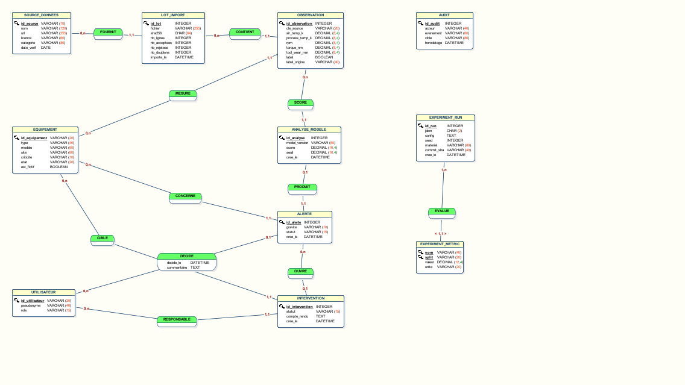
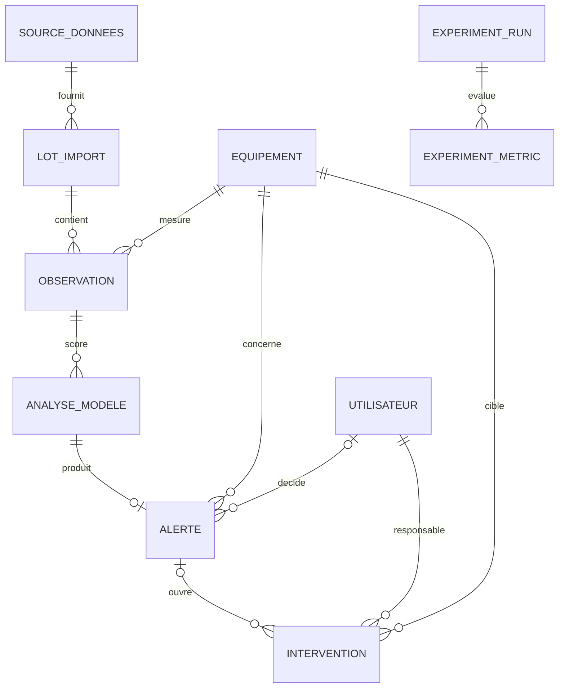

# RCS-41 — MCD (règles de gestion, entités, associations, cardinalités)

Pilote : Omar · binôme : Gémima · relecteur : Elias. Le MLD et le SQL sont livrés par RCS-42.

✅ **MCD saisi dans JMerise (24/11)** : `docs/jmerise/RCS41_MCD_RoboCare.mcd` (fichier JMerise 0.6.3) et son export `docs/jmerise/RCS41_MCD_RoboCare.png`. Il reste la **relecture métier** (Elias) avant de clore le ticket.



## 1. Règles de gestion

| RG | Règle |
|---|---|
| RG1 | Une source de données fournit 0..n lots d'import ; un lot provient d'une seule source. |
| RG2 | Un lot est identifié de façon unique par l'empreinte SHA-256 du fichier (idempotence). |
| RG3 | Un lot contient 0..n observations ; une observation appartient à un seul lot. |
| RG4 | Un équipement possède 0..n observations ; une observation concerne un seul équipement ; (équipement, clé source) est unique. |
| RG5 | Une observation est scorée par 0..n analyses, au plus une par version de modèle. |
| RG6 | Une analyse produit 0 ou 1 alerte (si score ≥ seuil) ; une alerte provient d'une seule analyse. |
| RG6b | L'équipement d'une alerte est celui de l'observation analysée (revue d'Aminata, PR #19 : triggers SQL). |
| RG7 | Une alerte est décidée (validée/rejetée) par 0..1 utilisateur habilité (technicien, responsable). |
| RG7b | Une alerte validée ou rejetée a obligatoirement un décideur et une date de décision (revue PR #19 : `CHECK`). |
| RG8 | Une intervention est ouverte sur une alerte **validée** (ou un incident manuel : alerte nulle) ; une alerte peut donner 0..n interventions. |
| RG9 | Toute action sensible produit une ligne d'audit (acteur, événement, cible, horodatage UTC). |
| RG10 | Une exécution d'expérience (J1/J2) possède 1..n métriques ; une métrique est identifiée par (run, nom, split), `split` obligatoire (revue PR #19). |

## 2. MCD (notation Merise : cardinalités min,max côté entité)

```
SOURCE_DONNEES (0,n) ── FOURNIT ── (1,1) LOT_IMPORT
LOT_IMPORT     (0,n) ── CONTIENT ── (1,1) OBSERVATION
EQUIPEMENT     (0,n) ── MESURE ──── (1,1) OBSERVATION
OBSERVATION    (0,n) ── SCORE ───── (1,1) ANALYSE_MODELE
ANALYSE_MODELE (0,1) ── PRODUIT ─── (1,1) ALERTE
EQUIPEMENT     (0,n) ── CONCERNE ── (1,1) ALERTE
UTILISATEUR    (0,n) ── DECIDE ──── (0,1) ALERTE         [date, commentaire]
ALERTE         (0,n) ── OUVRE ───── (0,1) INTERVENTION
UTILISATEUR    (0,n) ── RESPONSABLE (1,1) INTERVENTION
EQUIPEMENT     (0,n) ── CIBLE ───── (1,1) INTERVENTION
EXPERIMENT_RUN (1,n) ── EVALUE ──── (1,1) EXPERIMENT_METRIC   [identification relative]
```

Entités et identifiants : SOURCE_DONNEES(**id**, nom, url, licence, catégorie, date_verif) ;
LOT_IMPORT(**id**, fichier, sha256, nb_lignes, nb_acceptées, nb_rejetées, nb_doublons, importé_le) ;
EQUIPEMENT(**id**, type, modèle, site, criticité, état, est_fictif) ;
OBSERVATION(**id**, clé_source, air_temp_k, process_temp_k, rpm, torque_nm, tool_wear_min, label, label_origine) ;
ANALYSE_MODELE(**id**, model_version, score, seuil, créé_le) ; ALERTE(**id**, gravité, statut, créé_le) ;
INTERVENTION(**id**, statut, compte_rendu, créé_le) ; UTILISATEUR(**id**, pseudonyme, rôle) ;
AUDIT(**id**, acteur, événement, cible, horodatage) ; EXPERIMENT_RUN(**id**, jalon, config, seed, matériel, commit_sha, créé_le) ;
EXPERIMENT_METRIC(**nom**, **split**, valeur, unité) — identifiant relatif : (run, nom, split), lien `(1,1)` vers EXPERIMENT_RUN.

L'association MESURE_RUN est renommée **EVALUE** pour ne pas être confondue avec MESURE (équipement–observation) dans JMerise.

AUDIT est volontairement non relié par clé étrangère (journal append-only, la cible est textuelle).


## Alignement SQL canonique (#19)
Le champ documentaire `EXPERIMENT_RUN.commit_sha` reprend le nom SQL canonique. Le binaire JMerise et le PNG ci-dessus n'ont pas été modifiés par cette correction : Omar doit contrôler/aligner leur attribut, régénérer le MLD depuis JMerise puis comparer au SQL, et Elias doit valider visuellement la v1.
Alerte et observation liée doivent partager l'équipement ; décision terminale avec acteur et date ; clé métrique (run_id, nom, split non nul). Run sans métrique possible avant clôture : 0..n en SQL, 1..n exigé à la clôture. Intervention manuelle sans alerte : concept cible, pas implémenté par l'API RCS-50. Audit append-only par convention, non garanti en SQL.



Diagramme Mermaid de lecture rapide ; la référence est l'export JMerise ci-dessus. Les types JMerise reprennent ceux du schéma SQL de la PR #19 (TEXT → VARCHAR borné, REAL → DECIMAL, INTEGER 0/1 → BOOLEAN au niveau conceptuel).

## 3. Export JMerise

| Fichier | Contenu |
|---|---|
| `docs/jmerise/RCS41_MCD_RoboCare.mcd` | MCD JMerise 0.6.3 : 11 entités, 11 associations, 22 liens et cardinalités, règles de gestion RG1 à RG10 (avec RG6b et RG7b) dans les propriétés du MCD |
| `docs/jmerise/RCS41_MCD_RoboCare.png` | Export image du MCD complet depuis JMerise |

Ouvrir : JMerise → Fichier → Ouvrir → `docs/jmerise/RCS41_MCD_RoboCare.mcd`. Le MLD peut être régénéré depuis JMerise et comparé au SQL de la PR #19.

## Périmètre v1 et évolution v2

Le guide BDD du 25/11/2026 reçu d'Omar propose une cible PostgreSQL 16 / stockage objet / Parquet (médaillon Bronze/Silver/Gold) et un brouillon SQL multimodal de 30 tables. Ce brouillon n'est pas une livraison de cette PR, ni une preuve de migration ou de validation collective. Conserver la v1 SQLite/AI4I, traiter MCD v2 et MPD PostgreSQL dans les compléments RCS-41/RCS-42 ou un ticket dédié après arbitrage d'équipe ; aucun nouveau branchement TP08 avant feu vert collectif. La comparaison JMerise v1/SQL reste requise.
