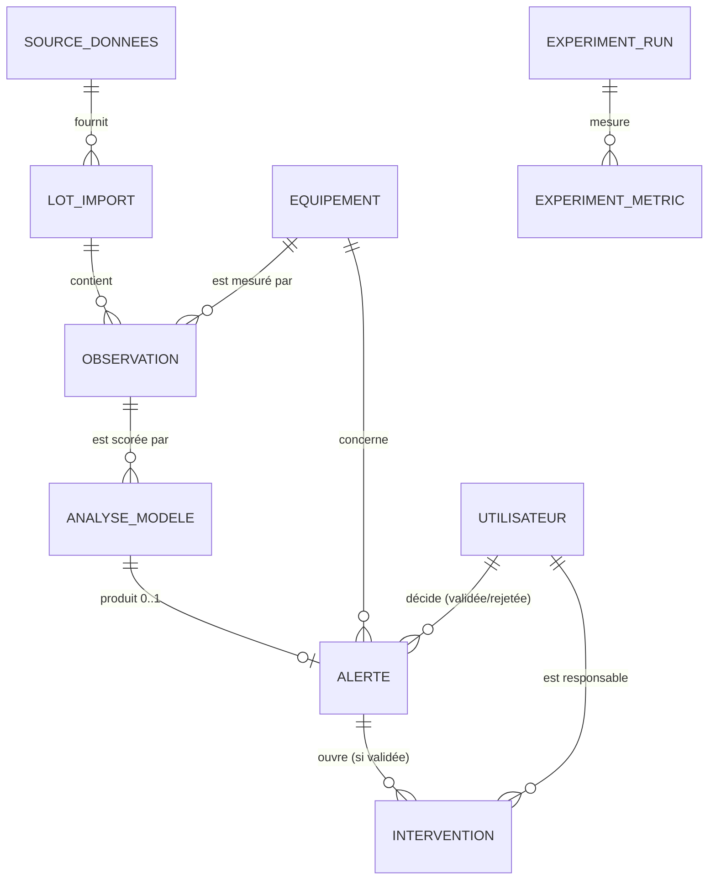

# RCS-50 — Stockage du POC (SQLite)

Pilote : Omar · binôme : Ayoub · relectrice : Gémima.

Script : `sql/001_init_schema.sql`, appliqué par `src/rcs/db.py` (migrations tracées dans `schema_migrations`).
Le MCD/MLD **JMerise** officiel (tickets `DB · Dessiner MCD` / `Générer MLD`) reste à produire dans l'outil ;
ce schéma en est une implémentation de travail à confronter au MCD.

## Règles de gestion implémentées

| Règle | Mécanisme | Test |
|---|---|---|
| Un fichier = un lot | `lot_import.sha256 UNIQUE` | `test_same_file_twice_is_idempotent` |
| Une observation unique par (équipement, clé source) | `UNIQUE(equipement_id, cle_source)` | `test_overlapping_file_does_not_duplicate_observations` |
| Une analyse par (observation, version de modèle) | `UNIQUE(observation_id, model_version)` | `test_alert_workflow_unique_and_human_review` |
| Une analyse produit au plus une alerte | `alerte.analyse_id UNIQUE` | idem |
| Statuts contrôlés | `CHECK` sur `statut`, `gravite`, `role`, `criticite` | — |
| Intégrité référentielle | `PRAGMA foreign_keys = ON` | `test_foreign_keys_enforced` |
| Intervention uniquement sur alerte validée, rôle habilité | `rcs/alerts.py` | `test_alert_workflow_unique_and_human_review` |
| Toute décision auditée (acteur, événement, cible, UTC) | table `audit` | idem |

Index : `idx_obs_equipement`, `idx_alerte_statut`. Passage PostgreSQL : types compatibles ; remplacer
`AUTOINCREMENT` par `GENERATED ALWAYS AS IDENTITY` et gérer les migrations (Alembic) — à décider en équipe.

Tests de migrations et de contraintes CHECK : branche RCS-42 (`tests/test_rcs42_sql.py`).
