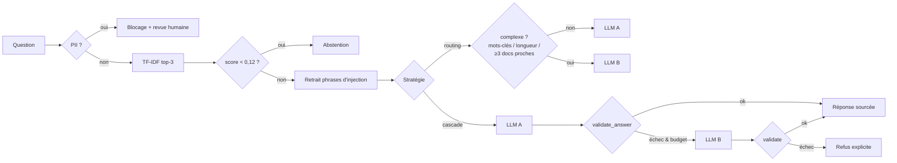

# TP04 — Architecture V2 Multi-LLM

## 1. Défaut observé de la V1 (TP03)

La V1 mono-LLM (modèle B, RAG) répond correctement sur une partie des cas mais : (a) **chaque question paie le modèle le
plus coûteux**, y compris les questions factuelles simples ; (b) sur certains cas le modèle omet la citation ou ne
renvoie que « Sources: [DOCxx] » — sortie inexploitable qui doit être détectée (cf. `docs/35_rcs77_tp03_v1_plan_v2.md` §4).
La V2 doit donc **réduire le recours au modèle robuste sans dégrader les cas difficiles**, avec une vérification
explicite de la sortie.

## 2. Modèles

| Rôle | Nom exact / révision | Fournisseur | Licence | Exécution | Entrée → sortie |
|---|---|---|---|---|---|
| **A** économique | `HuggingFaceTB/SmolLM2-360M-Instruct` @ `a10cc15` | Hugging Face (TB) | Apache-2.0 | local CPU, fp32, glouton, 120 tokens max | question + 3 passages → réponse + `Sources: [DOCxx]` |
| **B** robuste | `Qwen/Qwen2.5-0.5B-Instruct` @ `7ae5576` | Alibaba Qwen | Apache-2.0 | local CPU, fp32, glouton, 120 tokens max | idem |

Deux modèles de langage **distincts** (familles, tailles et données d'entraînement différentes). Traitement 100 % local :
aucune donnée ne quitte le poste (pas de transfert vers un fournisseur tiers).

## 3. Patrons implémentés (`src/rcs/j2/orchestrator.py`)

| Patron | Qui décide ? | Règle | Indicateur qui tranche |
|---|---|---|---|
| **routing** | règle déterministe sur la **question** + scores de recherche (jamais la réponse attendue) | B si marqueur de complexité (`pourquoi`, `compar…`, `différence`, `expliqu…`…), > 18 mots, ou ≥ 3 documents à ≥ 70 % du meilleur score | qualité par sous-groupe + nb d'appels B |
| **cascade A→B** | validateur `validate_answer` | A d'abord ; escalade vers B si sortie vide, trop longue, sans citation, citation hors contexte, « citation seule », ou charge d'injection ; **max 2 appels** ; sinon refus | taux d'escalade + p95 |

Contrat de chaque appel (trace JSONL) : `trace_id, case_id, category, strategy, question_sha256` (pas la question en
clair), `route, models (nom@révision), call_count, latency_ms, input/output_tokens, status, error_type, validation,
guard_events, retrieved, answer, cost_eur (null en local), score`.

Pannes : timeout par modèle (A 60 s, B 90 s via `max_time`), exception capturée → `status=error` + `error_type`
(pas d'exception masquée), budget d'appels borné, aucune boucle de retry non bornée. Testé hors-ligne :
`tests/test_j2_orchestrator.py::test_cascade_budget_and_outage_of_b`.

## 4. Hypothèse H2 (posée avant l'exécution)

« Sur le jeu de test gelé `experiments/test_cases.jsonl` (10 cas), l'architecture **cascade A→B** atteint une qualité
**≥ mono-B** en réduisant les appels au modèle B d'au moins **30 %**, tout en respectant **p95 ≤ 1,2 × p95(mono-B)** et un
coût (énergie estimée) ≤ mono-B. » Abandon de la V2 au profit de mono-B si la qualité des cas critiques (stress)
baisse ou si p95 dépasse la borne.

## 5. Ablations prévues (une variable à la fois)

1. `noguards_` : garde-fous déterministes désactivés (PII, injection, hors périmètre, validateur) — mesure ce que
   les LLM font seuls sur les cas de stress.
2. `route8w_` : seuil de longueur du routeur abaissé de 18 à 8 mots (plus de cas vers B).
3. (TP05) `tok60_` : `max_new_tokens` 120 → 60 (levier FinOps/Green).
