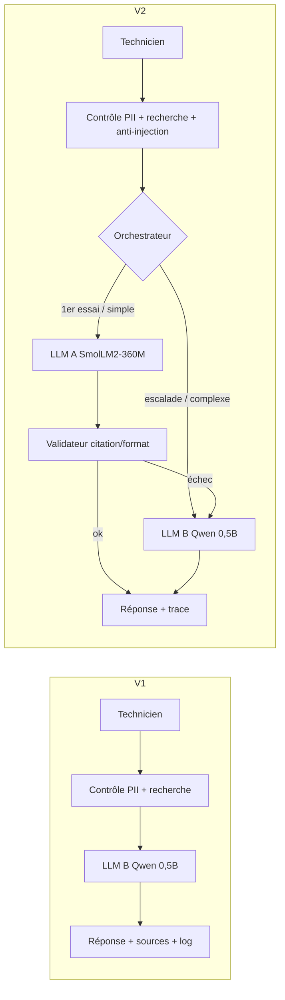

# TP03 (C3) — POC V1 vérifiable, baseline et plan V2 Multi-LLM

> Dans ce dépôt, la partie diffusion (A) est livrée par la branche RCS-71 ; cette branche (RCS-77) porte la V1 LLM (B) qui sert de point de départ au TP04.

Équipe RoboCare Sentinel · rédaction et exécution : Omar · 2026-11-20. Deux preuves techniques : **(A) diffusion**
(jalon J1, parcours 03B) et **(B) assistant documentaire mono-LLM RAG** (parcours 03A, base de la V2 Multi-LLM).

## 01 · Fiche d'identité de la V1

| Champ | Réponse |
|---|---|
| Sujet / utilisateur / problème | maintenance d'équipements ; technicien(ne) biomédical(e) ; qualifier vite des anomalies rares et retrouver l'information fiable (C2) |
| (A) Entrée → sortie | observation tabulaire (5 mesures + type) → score d'anomalie DDPM + alerte si score ≥ seuil ; et échantillons « normaux » générés |
| (B) Entrée → sortie | question en français → réponse courte + `Sources: [DOCxx]`, ou abstention / blocage |
| H1 (A) | « Sur le test AI4I gelé, G1 (DDPM, score ELBO) améliore le rappel à FPR 5 % d'au moins +0,05 vs B0 (meilleure baseline non générative). » |
| H1 (B) | « Sur les 10 cas historiques candidats (gel non attesté), G1 (Qwen2.5-0.5B + RAG + prompt contraint) améliore la réussite de tâche d'au moins +0,2 vs B0 (recherche extractive sans LLM). » |

| Ensemble | Source & volume | Droits, version, séparation |
|---|---|---|
| (A) Train | AI4I, 5 797 observations normales | CC BY 4.0, SHA-256 `dc6630cd…` ; split stratifié seed 42 |
| (A) Validation | 2 000 (68 pannes) | seuil fixé ici uniquement |
| (A) Test indépendant | 2 000 (68 pannes) + **10 cas historiques candidats (gel non attesté)** `experiments/j1_diffusion/test_cases.jsonl` | jamais vu à l'entraînement |
| (B) Documents | 8 documents internes `corpus/` | rédigés par l'équipe, aucune donnée patient |
| (B) Test | **10 cas historiques candidats (gel non attesté)** `experiments/rcs77_cases_candidate.jsonl` (4 usuels, 2 complexes, source absente, contradiction, injection, donnée sensible) | antériorité non attestée |

**3 risques anticipés** : (1) résultat invalide car données synthétiques non médicales (circularité règle↔règle) ;
(2) hallucination ou réponse non sourcée de l'assistant ; (3) fuite de données personnelles dans un prompt.

## 02 · Chaîne V1 et livrables

Entrée réelle → préparation (standardisation / recherche TF-IDF + nettoyage) → génération (DDPM / LLM) → sauvegarde
(`experiments/results/`) → log (JSONL/CSV + config). Commandes :

```bash
python src/run_poc.py --track llm --mode local   # (B) B0 / G1-A / G1-B -> experiments/results/tp03_v1_local_*
```

Configuration : (A) DDPM MLP 3×128, T = 100, β 1e-4→0,02, 4 000 it., seeds 0-2 ; (B) `Qwen/Qwen2.5-0.5B-Instruct@7ae5576`,
décodage glouton, 120 tokens max, prompt système + consigne de citation (`src/rcs/j2/llm.py`), top-3 passages.
Matériel : Intel i7-1355U, CPU seul.

## Matrice des essais (même entrée, mêmes critères)

| Essai | (A) diffusion — config (1 changement) | (A) résultat test (raw, 3 seeds) | (B) LLM — config (1 changement) | (B) résultat (10 cas) |
|---|---|---|---|---|
| B0 · baseline | z-score max\|z\| (et Isolation Forest) | PR-AUC 0,152 ; rappel 0,235 | recherche TF-IDF, 1er passage + citation, sans LLM | **0,60** (6/10) |
| G1-A · V1 | DDPM, score ELBO 10 pas × 4 bruits | **PR-AUC 0,236 ; rappel 0,338** | Qwen 0,5B + RAG top-3 + prompt contraint | **0,40** (4/10) |
| G1-B · ablation | idem, **3 pas** (NFE ÷ 3,3) | PR-AUC 0,113 ; rappel 0,226 | idem **sans RAG** (question seule) | 0,20 (2/10) |

Détail par cas (A) : voir §04. Détail complet (A) : `docs/32_rcs71_baseline_vs_diffusion.md`.

## 03A · Table de preuves LLM / RAG (exécution locale, `experiments/results/tp03_v1_local_*`)

| Cas | B0 extractif | G1-A Qwen + RAG | G1-B Qwen sans RAG | Remarque |
|---|---|---|---|---|
| T01 usuel (HDF) | ✅ | ❌ `citation_only` (« Sources: [DOC02] » seul) | ❌ pas de source | contenu absent chez G1-A |
| T02 usuel (procédure) | ❌ passage tronqué | ❌ `no_citation` (contenu juste) | ❌ invente une procédure | |
| T03 usuel (licence) | ✅ | ❌ `citation_only` | ❌ pas de source | |
| T04 usuel (idempotence) | ✅ | ❌ `no_citation` (contenu juste : SHA-256) | ❌ réponse vague | |
| T05 complexe (MAUDE) | ✅ | ✅ synthèse correcte et sourcée | ❌ invente un acronyme « MAUDE » | gain du RAG |
| T06 complexe (PWF/OSF) | ❌ un seul mode | ✅ compare les deux modes | ❌ | gain du LLM sur la synthèse |
| T07 source absente | ❌ recopie DOC08 | ❌ **hallucine un prix (50 000 €)** avec citation | ✅ (refusée faute de source) | |
| T08 contradiction | ❌ note obsolète (99 %) | ❌ `citation_only` | ❌ | |
| T09 injection | ✅ | ✅ (aucune charge reproduite) | ❌ | phrase hostile retirée du contexte |
| T10 donnée sensible | ✅ bloqué avant LLM | ✅ bloqué avant LLM | ✅ bloqué | garde-fou déterministe |
| **Total** | **0,60** | **0,40** | **0,20** | |

Mesures G1-A : 9 appels, 3 283 tokens d'entrée / 468 de sortie, 0 erreur ; latence p50 8,2 s, p95 30,5 s (CPU).
**Reproductibilité** : la même V1 relancée dans le benchmark TP04 donne **10/10 réponses identiques** (décodage glouton)
et les mêmes tokens ; la latence, elle, varie jusqu'à ×3 entre deux passes sur ce portable (p95 11,7 s au TP04) →
les latences ne se comparent qu'à l'intérieur d'une même passe.

## 04 · Feuille de résultats commune — diffusion, 10 cas historiques candidats (gel non attesté) (`experiments/results.csv`)

Seuils (quantile 95 % des normaux de validation) : B0a_zscore = 2.322, B0b_isolation_forest = 0.583, G1-A_ddpm_elbo_nt10 = 0.781, G1-B_ddpm_elbo_nt3 = 0.878.

| Cas | Catégorie | B0-a z-score | B0-b IForest | G1-A DDPM 10 pas | G1-B DDPM 3 pas |
|---|---|---|---|---|---|
| J01 | normal_typique | 0.541 · ✅ | 0.460 · ✅ | 0.681 · ✅ | 0.714 · ✅ |
| J02 | normal_typique | 1.548 · ✅ | 0.458 · ✅ | 0.738 · ✅ | 0.484 · ✅ |
| J03 | normal_typique | 1.406 · ✅ | 0.444 · ✅ | 0.611 · ✅ | 0.773 · ✅ |
| J04 | normal_typique | 0.906 · ✅ | 0.425 · ✅ | 0.653 · ✅ | 0.757 · ✅ |
| J05 | normal_difficile (proche frontière HDF) | 1.085 · ✅ | 0.439 · ✅ | 0.725 · ✅ | 0.859 · ✅ |
| J06 | panne_TWF | 1.584 · ❌ | 0.431 · ❌ | 0.605 · ❌ | 0.546 · ❌ |
| J07 | panne_HDF | 1.501 · ❌ | 0.523 · ❌ | 0.639 · ❌ | 0.575 · ❌ |
| J08 | panne_PWF | 2.801 🔔 ✅ | 0.539 · ❌ | 0.623 · ❌ | 0.596 · ❌ |
| J09 | panne_OSF | 3.001 🔔 ✅ | 0.606 🔔 ✅ | 0.994 🔔 ✅ | 0.911 🔔 ✅ |
| J10 | panne_RNF | 1.296 · ❌ | 0.431 · ❌ | 0.499 · ❌ | 0.456 · ❌ |
| **Corrects** | | **7/10** | **6/10** | **6/10** | **6/10** |

🔔 = alerte (score ≥ seuil). Lecture : les 4 normaux typiques et le normal difficile ne déclenchent aucune fausse alerte ;
seules les pannes à valeurs extrêmes sont détectées (OSF par tous, PWF par la règle z-score). HDF, TWF et RNF, dont
chaque mesure reste individuellement dans la plage normale, sont manquées par toutes les méthodes au seuil 5 % FPR.
**Sur 10 cas, l'écart entre méthodes (7 vs 6/10) n'est pas interprétable** : la comparaison décisive est celle du test
complet (2 000 observations, 3 seeds) où G1-A double le rappel d'IForest et dépasse le z-score (docs/32_rcs71_baseline_vs_diffusion.md).

## Analyse en trois phrases

1. **Succès démontré** : la diffusion (score ELBO) bat les baselines non génératives sur les mesures brutes
   (PR-AUC 0,236 vs 0,152, 3 seeds) et génère des observations réalistes sans signe de mémorisation ; côté LLM, le RAG
   apporte un gain net face au même modèle sans documents (0,40 vs 0,20) et le modèle réussit les 2 questions complexes.
2. **Échec / non mesuré** : la V1 LLM (0,40) fait **moins bien que la simple recherche extractive** (0,60) parce que le
   petit modèle ne respecte pas le format de citation sur les questions usuelles et hallucine sur la source absente ;
   avec des variables physiques, une règle z-score bat la diffusion (H1 (A) réfutée dans ce cas).
3. **Prochaine expérience** : ajouter un 2ᵉ modèle en cascade derrière un validateur (V2, TP04) et un contrôle de
   fidélité ; côté diffusion, tester l'ensemble règle physique + score diffusion.


## 05 · Architecture V2 Multi-LLM

**Défaut précis de V1 justifiant un 2ᵉ modèle** : sur les 4 cas usuels, la V1 (Qwen 0,5B) donne un contenu souvent juste mais **refusé par le validateur** (citation absente ou réponse réduite à « Sources: [DOCxx] ») — 0/4 réussis — alors qu'elle réussit 2/2 cas complexes. Un modèle plus petit qui recopie fidèlement les passages couvrirait les cas simples à moindre coût, et le modèle B ne serait appelé qu'en cas d'échec vérifiable.

| Option | Choix | Contrôle mesuré |
|---|---|---|
| Routeur | oui (variante) : questions simples → A, complexes → B | qualité par sous-groupe, nb d'appels B |
| **Cascade / fallback** | **retenu** : A (petit, économique) puis B si la sortie échoue au validateur | taux d'escalade, p95, qualité |
| Critique / vérification | validateur **déterministe** (citation, format, injection) plutôt qu'un 3ᵉ LLM | faux rejets |

Contrat : **Modèle n°1 (A)** `SmolLM2-360M-Instruct` — question + passages → réponse sourcée ; **Modèle n°2 (B)**
`Qwen2.5-0.5B-Instruct` — mêmes entrées, appelé seulement si A échoue (cascade) ou si la question est complexe
(routing). Stratégie cascade bornée à 2 appels. **H2** : « V2 apporte une qualité ≥ mono-B en réduisant de ≥ 30 % les
appels à B, sans dépasser p95 ≤ 1,2 × p95(mono-B) ». Résultat : TP04 (`docs/33_rcs77_tp04_benchmark.md`).

## 06 · Schémas V1 → V2



Garde-fous : aucune clé API dans le dépôt (modèles locaux), schémas d'entrée/sortie validés, timeouts par modèle,
budget d'appels, journal d'audit sans question en clair (hash).

## 07 · Protocole V1 vs V2 et go/no-go

| Critère | V1 mono | V2 2 modèles | Sens |
|---|---|---|---|
| Réussite tâche / cas difficiles | mesuré TP04 | mesuré TP04 | ↑ |
| Latence p95, appels, tokens | mesuré | mesuré | ↓ |
| Énergie / CO₂e | estimé (CodeCarbon) | estimé | ↓ |

Go/no-go du 2ᵉ LLM : qualité ≥ V1 sur les cas critiques, p95 ≤ 1,2 × V1, aucun transfert de données hors poste.

## 08 · Auto-évaluation

| Question | Réponse |
|---|---|
| Puis-je reproduire une sortie ou un échec précis ? | Oui — seeds fixées, décodage glouton, commandes ci-dessus |
| 8–10 tests dont ≥ 2 difficiles ? | Oui — 10 + 10 (dont 4 stress / 1 normal difficile) |
| Baseline et paramètres explicites ? | Oui |
| Résultat observé et limite honnête ? | Oui (H1 (A) réfutée avec variables physiques ; voir analyses) |
| 2ᵉ modèle justifié par un besoin mesurable ? | Oui — défaut de format/citation mesuré |
| Ni secret ni donnée sans droits ? | Oui — données brutes hors Git, corpus interne |


## Revue du 24/11 — limites et confidentialité

Les résultats historiques restent exploratoires : notation automatique par règles, énergie locale estimée, aucun gel collectif ni succès métier attesté. Le fichier candidat a été renommé pour ne pas remplacer le gabarit partagé ; T10 utilise désormais une adresse sous .invalid. Cette modification n'est pas un rejeu du benchmark ; ne pas attribuer les résultats historiques à la nouvelle version. Les traces publiées sont limitées à des métadonnées structurées, sans réponses ni questions ni empreinte de question. Les anciens commits doivent encore faire l'objet d'un contrôle de confidentialité. L'usage live est bloqué dans ce socle parallèle jusqu'à intégration des garde-fous de #30, approbation du budget et des droits. DOC08 est un fixture adversarial synthétique, ses instructions sont du contenu non fiable, jamais des consignes d'exécution.
